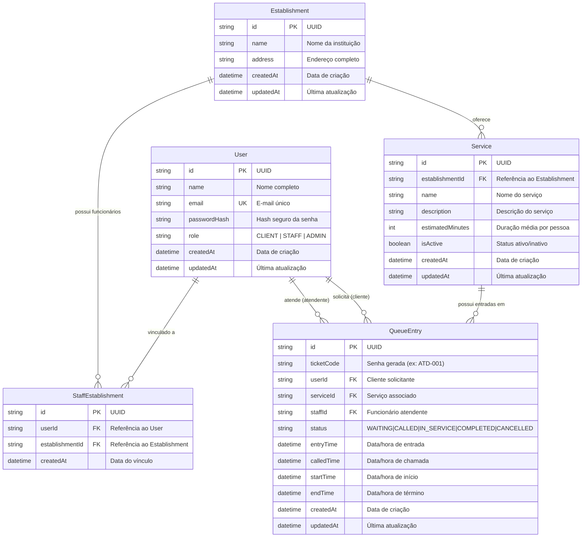

# FilaZero — Sistema Inteligente de Gerenciamento de Filas

## 1. Objetivo

O FilaZero é um sistema web de gerenciamento e acompanhamento de filas digitais voltado para estabelecimentos que realizam atendimento presencial ao público, como clínicas, escolas, laboratórios, empresas e órgãos públicos. O sistema resolve o problema das filas físicas desorganizadas, da aglomeração e da incerteza dos usuários, permitindo que eles retirem senhas digitais pelo celular ou computador, consultem sua posição exata e vejam o tempo estimado de espera antes de serem atendidos. Para os funcionários do estabelecimento, a plataforma fornece um painel centralizado para chamar, iniciar e finalizar atendimentos de forma ordenada, segura e transparente.

---

## 2. Usuários

O sistema possui três perfis de usuários bem definidos, com responsabilidades e níveis de acesso distintos:

1. **Usuário Comum (Cidadão / Cliente):**
   - **Permissões e Ações:** Pode criar uma conta pessoal, autenticar-se na plataforma, visualizar a listagem pública de estabelecimentos cadastrados e seus respectivos serviços disponíveis, entrar na fila de um serviço específico gerando uma senha digital de atendimento, consultar em tempo real sua posição na fila, o total de pessoas à sua frente e a estimativa simples de tempo de espera, acompanhar a mudança de estado da sua senha (Aguardando, Chamado, Em Atendimento, Concluído ou Cancelado) e cancelar voluntariamente sua própria entrada na fila enquanto ela estiver no estado "Aguardando".
   - **Restrições:** Não tem permissão para visualizar dados confidenciais de outros usuários, não pode acessar telas operacionais de funcionários nem alterar o status de senhas que não sejam a sua própria solicitação de cancelamento.

2. **Funcionário (Atendente):**
   - **Permissões e Ações:** Pode autenticar-se no sistema com credenciais vinculadas a um estabelecimento específico, acessar a fila de atendimento dos serviços sob sua responsabilidade, visualizar a lista ordenada de usuários aguardando atendimento (código da senha, nome do cidadão, horário de entrada e status), acionar a chamada do próximo usuário da fila respeitando estritamente a ordem cronológica, marcar o início efetivo do atendimento e registrar a conclusão/finalização do atendimento.
   - **Restrições:** Tem acesso restrito exclusivamente ao estabelecimento e aos serviços aos quais está formalmente vinculado, não podendo visualizar nem operar filas de outros estabelecimentos, nem alterar configurações cadastrais da instituição.

3. **Administrador (Gestor do Estabelecimento):**
   - **Permissões e Ações:** Realiza a gestão estrutural do estabelecimento no sistema, incluindo o cadastro e atualização de serviços oferecidos (com definição do tempo médio estimado por atendimento em minutos), o gerenciamento da ativação de serviços e a associação de contas de funcionários ao estabelecimento.
   - **Restrições:** Focado na gestão operacional e de acesso do estabelecimento, sem intervir em dados globais de outros estabelecimentos da plataforma.

---

## 3. Casos de uso principais

A tabela a seguir relaciona os casos de uso centrais do FilaZero aos respectivos requisitos funcionais (RF) implementados no sistema:

| Identificador | Caso de Uso | Descrição Resumida | Requisitos Funcionais Relacionados |
| :--- | :--- | :--- | :--- |
| **UC01** | Cadastrar Usuário Comum | O visitante informa nome, e-mail e senha para criar sua conta no sistema. | RF01, RF03 |
| **UC02** | Autenticar Usuário (Login) | O usuário (comum, funcionário ou gestor) insere suas credenciais para acessar a plataforma. | RF02, RF14 |
| **UC03** | Consultar Estabelecimentos e Serviços | O usuário consulta os estabelecimentos cadastrados e a lista de serviços ativos disponíveis. | RF04 |
| **UC04** | Entrar na Fila de Atendimento | O usuário escolhe um serviço ativo e solicita entrada na fila, recebendo uma senha sequencial única. | RF05, RF06 |
| **UC05** | Acompanhar Posição e Tempo de Espera | O usuário visualiza o status da sua senha, quantidade de pessoas à sua frente e tempo estimado de espera. | RF07, RF08 |
| **UC06** | Cancelar Entrada na Fila | O usuário cancela sua entrada ativa enquanto ela ainda estiver no estado "Aguardando". | RF09 |
| **UC07** | Visualizar Fila de Atendimento | O funcionário acessa o painel do seu estabelecimento e visualiza as senhas ativas do serviço. | RF10, RF14 |
| **UC08** | Chamar Próximo Usuário | O funcionário convoca o próximo usuário da fila cronológica, alterando seu estado para "Chamado". | RF11 |
| **UC09** | Iniciar Atendimento | O funcionário confirma o início do atendimento presencial do usuário chamado. | RF12 |
| **UC10** | Finalizar Atendimento | O funcionário conclui o atendimento corrente, liberando o posto para a próxima chamada. | RF13 |
| **UC11** | Gerenciar Serviços do Estabelecimento | O administrador cadastra e configura os serviços do estabelecimento e sua duração média estimada. | RF04, RF08, RF15 |

---

## 4. Requisitos funcionais

A lista abaixo apresenta todos os requisitos funcionais do sistema FilaZero, identificados de forma única e verificável:

- **RF01 — Cadastro de Usuário:** O sistema deve permitir que novos usuários comuns se cadastrem fornecendo obrigatoriamente nome completo, endereço de e-mail válido e senha com no mínimo 6 caracteres, rejeitando e-mails já existentes no banco de dados.
- **RF02 — Autenticação de Usuário (Login e Logout):** O sistema deve autenticar usuários mediante fornecimento de e-mail e senha corretos, gerando uma sessão segura, além de permitir o encerramento da sessão ativa (logout).
- **RF03 — Persistência e Proteção de Credenciais:** O sistema deve persistir os dados cadastrais no banco de dados relacional e armazenar a senha criptografada por meio de função de hash irreversível.
- **RF04 — Listagem de Estabelecimentos e Serviços:** O sistema deve permitir a consulta pública de estabelecimentos cadastrados e de seus respectivos serviços ativos, exibindo nome do local, descrição do serviço e tempo médio estimado de atendimento por pessoa.
- **RF05 — Entrada na Fila Digital:** O sistema deve permitir que um usuário autenticado entre na fila de um serviço ativo, criando um registro de entrada persistido no banco com data e hora exatas da solicitação.
- **RF06 — Geração de Código Identificador de Senha:** O sistema deve gerar automaticamente um código identificador legível e sequencial para cada entrada na fila (por exemplo: "ATD-001", "LAB-014"), garantindo que cada atendimento possua identificação única no dia e serviço.
- **RF07 — Consulta de Posição e Pessoas à Frente:** O sistema deve calcular e exibir para o usuário sua posição atual na fila e o número de pessoas à sua frente, computando exclusivamente as entradas com estado "Aguardando" criadas anteriormente à sua entrada.
- **RF08 — Cálculo da Estimativa de Espera:** O sistema deve calcular e exibir a estimativa simples de tempo de espera do usuário, obtida pela multiplicação da quantidade de pessoas à frente pela duração média configurada para o respectivo serviço, informando textualmente tratar-se de uma estimativa e não de horário garantido.
- **RF09 — Cancelamento de Entrada pelo Usuário:** O sistema deve permitir que o usuário cancele sua própria entrada na fila a qualquer momento, desde que o atendimento ainda esteja no estado "Aguardando", alterando o status para "Cancelado" e recalculando a posição dos demais usuários.
- **RF10 — Visualização Operacional da Fila pelo Funcionário:** O sistema deve permitir que o funcionário autenticado visualize a lista de entradas ativas do serviço sob sua responsabilidade, ordenadas pela sequência cronológica de chegada, contendo código da senha, nome do usuário, horário de entrada e status atual.
- **RF11 — Chamada do Próximo Usuário:** O sistema deve permitir que o funcionário chame o próximo usuário que estiver com status "Aguardando", alterando seu status para "Chamado", registrando o carimbo de data/hora da chamada e associando o funcionário responsável.
- **RF12 — Registro de Início de Atendimento:** O sistema deve permitir que o funcionário inicie o atendimento presencial do usuário previamente chamado, alterando o status da entrada de "Chamado" para "Em Atendimento" e registrando o respectivo carimbo de data/hora.
- **RF13 — Conclusão de Atendimento:** O sistema deve permitir que o funcionário finalize o atendimento em curso, alterando o status da entrada de "Em Atendimento" para "Concluído", registrando o carimbo de data/hora de encerramento e liberando o painel para uma nova chamada.
- **RF14 — Controle de Acesso e Restrição por Perfil:** O sistema deve bloquear o acesso de usuários comuns às páginas e rotas de funcionários (`/staff` ou equivalente) e garantir que funcionários acessem apenas os serviços do estabelecimento ao qual estão vinculados.
- **RF15 — Tratamento de Fila Vazia e Estados Especiais:** O sistema deve exibir mensagens claras e amigáveis quando a fila estiver vazia ("Nenhum usuário aguardando no momento") ou quando o usuário não tiver senhas ativas, impedindo ações inconsistentes (como acionar botão de chamada quando não há pessoas na fila).

---

## 5. Requisitos não funcionais

Os requisitos não funcionais definem os critérios técnicos de qualidade, segurança, desempenho e usabilidade que regem a arquitetura do FilaZero:

### Segurança
- **RNF01 — Hash de Senhas:** Nenhuma senha de usuário deve ser armazenada em texto puro sob nenhuma circunstância. Todas as senhas devem ser criptografadas utilizando algoritmos de hash unidirecional seguros (como bcrypt com fator de custo mínimo de 10 rounds ou argon2) antes de qualquer persistência no banco de dados.
- **RNF02 — Validação Obrigatória no Servidor:** Todos os dados recebidos de formulários e requisições devem ser validados rigorosamente no lado do servidor (Server Actions / API endpoints), verificando obrigatoriedade, tipos, comprimentos e padrões (e-mail válido, senhas com requisitos mínimos), não confiando exclusivamente em validações visuais do navegador.
- **RNF03 — Proteção contra SQL Injection:** Todas as operações de leitura e escrita no banco de dados relacional devem utilizar consultas parametrizadas fornecidas pelo Prisma ORM, impedindo qualquer forma de interpolação ou concatenação manual de strings SQL com dados do usuário.
- **RNF04 — Proteção de Rotas e Integridade de Autorização:** O sistema deve validar no servidor a autenticação e o nível de acesso (role) do usuário antes de renderizar páginas restritas ou executar ações de negócio, impedindo a visualização ou manipulação de dados sensíveis mediante simples alteração de URL no navegador.
- **RNF05 — Proteção de Variáveis Sensíveis:** Credenciais de banco de dados, chaves secretas de criptografia e tokens de sessão devem ser configurados estritamente em variáveis de ambiente (`.env` localmente e *Environment Variables* na plataforma de nuvem), sendo estritamente proibido o versionamento de qualquer credencial no repositório Git.
- **RNF06 — Comunicação Criptografada (HTTPS):** No ambiente de publicação na nuvem, todas as trocas de informação entre cliente e servidor devem ocorrer sob protocolo HTTPS com certificado SSL/TLS ativo.
- **RNF07 — Tratamento Seguro de Erros e Exceções:** Mensagens de erro apresentadas aos usuários não devem exibir detalhes internos de implementação, fragmentos de código, consultas SQL com falhas ou dados sensíveis. Erros inesperados devem exibir mensagens amigáveis e claras.

### Desempenho e Confiabilidade
- **RNF08 — Desempenho em Ambiente Educacional:** Para um ambiente acadêmico com carga média de até 50 usuários simultâneos, o tempo de resposta das requisições de consulta de fila e mudança de estado deve ser inferior a 2 segundos em condições normais de conexão com a internet.
- **RNF09 — Integridade Transacional e Consistência de Estado:** O avanço de estados das senhas (Aguardando → Chamado → Em Atendimento → Concluído) deve obedecer a regras atômicas, impedindo transições ilegais de estado ou que duas chamadas concorrentes atendam a mesma entrada.

### Usabilidade e Interface
- **RNF10 — Interface Web Responsiva:** A interface visual deve ser construída com layout responsivo utilizando Tailwind CSS, garantindo navegação fluida, legibilidade e usabilidade tanto em dispositivos móveis (smartphones com telas a partir de 360px de largura) quanto em computadores desktop (resoluções de até 1920x1080).

---

## 6. Modelo de dados (DER simples)

O modelo relacional do FilaZero foi estruturado para sustentar de maneira íntegra e normalizada todo o fluxo operacional das filas, a gestão de acessos e o isolamento de estabelecimentos.

### 6.1 Descrição das Tabelas e Entidades

1. **`User` (Usuários do Sistema):**
   - **Finalidade:** Armazena os dados das contas de acesso, tanto de usuários comuns quanto de funcionários e gestores.
   - **Campos:**
     - `id`: VARCHAR/UUID, Chave Primária (PK). Identificador único do usuário.
     - `name`: VARCHAR(120), NOT NULL. Nome completo do usuário.
     - `email`: VARCHAR(180), NOT NULL, UNIQUE. Endereço de e-mail utilizado para autenticação.
     - `passwordHash`: VARCHAR(255), NOT NULL. Hash seguro da senha de acesso (bcrypt).
     - `role`: VARCHAR(20), NOT NULL, DEFAULT 'CLIENT'. Papel do usuário (`CLIENT`, `STAFF`, `ADMIN`).
     - `createdAt`: TIMESTAMP, NOT NULL, DEFAULT CURRENT_TIMESTAMP. Data e hora de criação da conta.
     - `updatedAt`: TIMESTAMP, NOT NULL. Data e hora da última atualização.

2. **`Establishment` (Estabelecimentos):**
   - **Finalidade:** Representa as organizações físicas que oferecem atendimento ao público (ex.: clínicas, escolas, laboratórios).
   - **Campos:**
     - `id`: VARCHAR/UUID, Chave Primária (PK). Identificador único do estabelecimento.
     - `name`: VARCHAR(150), NOT NULL. Nome ou razão social do estabelecimento.
     - `address`: VARCHAR(255), NOT NULL. Endereço físico ou localização do estabelecimento.
     - `createdAt`: TIMESTAMP, NOT NULL, DEFAULT CURRENT_TIMESTAMP. Data e hora de cadastro.
     - `updatedAt`: TIMESTAMP, NOT NULL. Data e hora da última atualização.

3. **`StaffEstablishment` (Vínculo de Funcionários com Estabelecimentos):**
   - **Finalidade:** Tabela associativa que vincula funcionários aos seus respectivos estabelecimentos de trabalho. Garante que um funcionário só possa atender e gerenciar filas do estabelecimento ao qual foi atribuído.
   - **Campos:**
     - `id`: VARCHAR/UUID, Chave Primária (PK). Identificador único do vínculo.
     - `userId`: VARCHAR/UUID, Chave Estrangeira (FK -> `User.id`), NOT NULL. Identificador do usuário que atua como funcionário.
     - `establishmentId`: VARCHAR/UUID, Chave Estrangeira (FK -> `Establishment.id`), NOT NULL. Identificador do estabelecimento vinculado.
     - `createdAt`: TIMESTAMP, NOT NULL, DEFAULT CURRENT_TIMESTAMP. Data de associação.
   - **Restrições:** Restrição UNIQUE sobre o par `(userId, establishmentId)` para impedir vínculos redundantes.

4. **`Service` (Serviços Oferecidos):**
   - **Finalidade:** Cataloga os tipos de atendimento disponíveis em cada estabelecimento (ex.: "Matrícula Escolar", "Coleta de Sangue", "Atendimento Geral").
   - **Campos:**
     - `id`: VARCHAR/UUID, Chave Primária (PK). Identificador único do serviço.
     - `establishmentId`: VARCHAR/UUID, Chave Estrangeira (FK -> `Establishment.id`), NOT NULL. Estabelecimento prestador.
     - `name`: VARCHAR(100), NOT NULL. Título do serviço.
     - `description`: TEXT, NULLABLE. Descrição informativa sobre o atendimento.
     - `estimatedMinutes`: INTEGER, NOT NULL, DEFAULT 10. Tempo médio estimado por atendimento em minutos (utilizado no cálculo de espera).
     - `isActive`: BOOLEAN, NOT NULL, DEFAULT TRUE. Indica se o serviço está recebendo entradas na fila.
     - `createdAt`: TIMESTAMP, NOT NULL, DEFAULT CURRENT_TIMESTAMP.
     - `updatedAt`: TIMESTAMP, NOT NULL.

5. **`QueueEntry` (Entradas na Fila de Atendimento):**
   - **Finalidade:** Registra cada solicitação de entrada na fila gerada por um usuário, contendo o código da senha, carimbos temporais de cada etapa e o status corrente do atendimento.
   - **Campos:**
     - `id`: VARCHAR/UUID, Chave Primária (PK). Identificador único do registro de fila.
     - `ticketCode`: VARCHAR(15), NOT NULL. Código identificador da senha para exibição pública (ex.: "ATD-001").
     - `userId`: VARCHAR/UUID, Chave Estrangeira (FK -> `User.id`), NOT NULL. Usuário (cidadão) que solicitou a senha.
     - `serviceId`: VARCHAR/UUID, Chave Estrangeira (FK -> `Service.id`), NOT NULL. Serviço ao qual a fila pertence.
     - `staffId`: VARCHAR/UUID, Chave Estrangeira (FK -> `User.id`), NULLABLE. Funcionário responsável por chamar/atender a senha.
     - `status`: VARCHAR(20), NOT NULL, DEFAULT 'WAITING'. Estado do atendimento (`WAITING`, `CALLED`, `IN_SERVICE`, `COMPLETED`, `CANCELLED`).
     - `entryTime`: TIMESTAMP, NOT NULL, DEFAULT CURRENT_TIMESTAMP. Data e hora de entrada na fila.
     - `calledTime`: TIMESTAMP, NULLABLE. Data e hora em que a senha foi chamada pelo funcionário.
     - `startTime`: TIMESTAMP, NULLABLE. Data e hora de início efetivo do atendimento.
     - `endTime`: TIMESTAMP, NULLABLE. Data e hora de finalização ou cancelamento do atendimento.
     - `createdAt`: TIMESTAMP, NOT NULL, DEFAULT CURRENT_TIMESTAMP.
     - `updatedAt`: TIMESTAMP, NOT NULL.

### 6.2 Relacionamentos e Cardinalidades

- **`Establishment` 1 : N `Service`:** Um estabelecimento pode oferecer um ou muitos serviços; cada serviço pertence a exatamente um estabelecimento.
- **`Establishment` 1 : N `StaffEstablishment`:** Um estabelecimento pode ter nenhum ou muitos funcionários associados; cada registro de vínculo refere-se a um estabelecimento.
- **`User` 1 : N `StaffEstablishment`:** Um usuário com perfil de funcionário pode estar vinculado a um ou mais estabelecimentos através desta tabela associativa.
- **`User` 1 : N `QueueEntry` (como solicitante):** Um usuário comum pode realizar várias entradas na fila ao longo do tempo; cada entrada pertence a um único usuário.
- **`Service` 1 : N `QueueEntry`:** Um serviço recebe várias entradas de fila sequenciais; cada entrada de fila pertence a exatamente um serviço.
- **`User` 1 : N `QueueEntry` (como atendente):** Um funcionário pode atender e finalizar várias entradas de fila; o campo `staffId` vincula o funcionário à entrada atendida.

### 6.3 Diagrama Entidade-Relacionamento (Mermaid)

---

## 7. Critérios de aceite

Os critérios de aceite a seguir estão descritos no formato BDD (*Behavior-Driven Development*) — “Dado que..., quando..., então...” —, cobrindo cenários positivos e negativos para cada requisito funcional principal:

### Cadastro de Usuários (RF01, RF03)
- **CA01 — Cadastro com dados válidos:**
  *Dado que* um visitante preenche o formulário de cadastro com nome "Ana Pereira", e-mail "ana@email.com" e senha com 8 caracteres,
  *quando* submete o formulário,
  *então* o sistema cria a conta no banco de dados com a senha criptografada em hash, exibe mensagem de sucesso e redireciona para a tela de login.
- **CA02 — Cadastro com e-mail já existente (Negativo):**
  *Dado que* já existe um usuário cadastrado com o e-mail "ana@email.com",
  *quando* outro visitante tenta se cadastrar utilizando esse mesmo e-mail,
  *então* o sistema rejeita a operação no servidor e exibe a mensagem de erro "Este e-mail já está cadastrado".
- **CA03 — Validação de campos obrigatórios no servidor (Negativo / RNF02):**
  *Dado que* um visitante envia a requisição de cadastro com o campo nome em branco ou senha com menos de 6 caracteres,
  *quando* a requisição chega ao servidor,
  *então* o servidor recusa a gravação no banco e retorna os respectivos erros de validação por campo.

### Autenticação e Sessão (RF02, RF03)
- **CA04 — Login bem-sucedido:**
  *Dado que* o usuário cadastrado informa seu e-mail e senha corretos,
  *quando* clica no botão "Entrar",
  *então* o sistema autentica as credenciais comparando o hash, inicia uma sessão segura e direciona o usuário à página inicial autenticada.
- **CA05 — Login com senha incorreta (Negativo):**
  *Dado que* o usuário informa um e-mail cadastrado, mas digita uma senha incorreta,
  *quando* submete a tentativa de login,
  *então* o sistema não cria a sessão, bloqueia o acesso e exibe a mensagem "E-mail ou senha inválidos", sem revelar qual dos campos está incorreto.

### Consulta e Entrada na Fila (RF04, RF05, RF06)
- **CA06 — Consulta de serviços disponíveis:**
  *Dado que* um usuário autenticado acessa a listagem de estabelecimentos,
  *quando* seleciona uma clínica cadastrada,
  *então* o sistema lista todos os serviços com `isActive = true`, exibindo nome, descrição e o tempo médio estimado.
- **CA07 — Entrada na fila e geração de senha:**
  *Dado que* o usuário "Carlos Lima" seleciona o serviço "Atendimento Geral" (prefixo "ATD") que já possui 2 senhas geradas hoje,
  *quando* clica em "Entrar na Fila",
  *então* o sistema cria um registro na tabela `QueueEntry` com status `WAITING`, gera a senha "ATD-003" e exibe o comprovante digital da senha na tela.
- **CA08 — Tentativa de entrada duplicada na mesma fila (Negativo):**
  *Dado que* o usuário já possui uma senha com status `WAITING` ou `CALLED` no serviço "Atendimento Geral",
  *quando* tenta solicitar uma nova senha para o mesmo serviço,
  *então* o sistema impede a nova entrada e exibe a mensagem "Você já possui uma senha ativa para este serviço".

### Acompanhamento e Estimativa de Espera (RF07, RF08)
- **CA09 — Cálculo correto de posição e tempo estimado:**
  *Dado que* o usuário possui a senha "ATD-005" com status `WAITING`, e existem exatamente 3 senhas com status `WAITING` anteriores a ele para o mesmo serviço (cuja duração média configurada é de 10 minutos),
  *quando* o usuário visualiza a tela de acompanhamento,
  *então* o sistema exibe que sua posição é a 4ª da fila, informa que há 3 pessoas à sua frente e exibe a mensagem: "Tempo estimado de espera: aproximadamente 30 minutos (estimativa baseada na média de 10 min por atendimento)".

### Cancelamento pelo Usuário (RF09)
- **CA10 — Cancelamento de senha no estado aguardando:**
  *Dado que* o usuário possui uma senha com status `WAITING`,
  *quando* clica no botão "Cancelar Minha Fila" e confirma a operação,
  *então* o sistema atualiza o status do registro para `CANCELLED`, preenche o `endTime` com o horário atual e remove a senha da contagem de pessoas à frente dos demais usuários.
- **CA11 — Tentativa de cancelamento de senha já em atendimento (Negativo):**
  *Dado que* a senha do usuário foi alterada para `IN_SERVICE` pelo funcionário,
  *quando* o usuário tenta acionar o cancelamento,
  *então* o sistema rejeita a operação e informa que senhas já em atendimento não podem ser canceladas pelo usuário.

### Painel do Funcionário e Fluxo de Atendimento (RF10, RF11, RF12, RF13, RF15)
- **CA12 — Visualização restrita da fila pelo funcionário:**
  *Dado que* o funcionário "João" está logado e vinculado à "Clínica Central",
  *quando* ele acessa o painel de atendimento (`/staff`),
  *então* o sistema exibe somente as senhas associadas aos serviços da "Clínica Central", ordenadas pela hora de entrada mais antiga primeiro.
- **CA13 — Chamada do próximo usuário:**
  *Dado que* a fila do serviço possui a senha "ATD-001" como a primeira com status `WAITING`,
  *quando* o funcionário clica em "Chamar Próximo",
  *então* o sistema atualiza o status de "ATD-001" para `CALLED`, registra o `calledTime`, associa o ID do funcionário e atualiza a visualização do usuário correspondente para "Você foi chamado! Dirija-se ao guichê".
- **CA14 — Início do atendimento presencial:**
  *Dado que* a senha "ATD-001" está com status `CALLED`,
  *quando* o funcionário clica em "Iniciar Atendimento",
  *então* o status da senha avança para `IN_SERVICE`, registra o `startTime` com o horário do clique e habilita o botão de conclusão.
- **CA15 — Finalização do atendimento:**
  *Dado que* a senha "ATD-001" está com status `IN_SERVICE`,
  *quando* o funcionário clica em "Finalizar Atendimento",
  *então* o status muda para `COMPLETED`, o sistema preenche o `endTime` e o funcionário fica apto a chamar a próxima senha da fila.
- **CA16 — Tentativa de chamar senha com fila vazia (Negativo / RF15):**
  *Dado que* não há nenhum usuário com status `WAITING` na fila do serviço,
  *quando* o funcionário acessa o painel de atendimento,
  *então* o botão "Chamar Próximo" é mantido desabilitado e o painel exibe a mensagem "Nenhum usuário aguardando atendimento".

### Controle de Acesso e Segurança (RF14, RNF04)
- **CA17 — Bloqueio de rota restrita para usuário comum (Negativo / RF14):**
  *Dado que* um usuário comum com perfil `CLIENT` está logado no sistema,
  *quando* tenta acessar diretamente a URL do painel de funcionários (`/staff`),
  *então* o middleware/servidor intercepta a requisição, impede a visualização da tela e redireciona o usuário para a página inicial com aviso de acesso não autorizado.

---

## 8. Decisão de stack e deploy

A escolha das tecnologias para a construção do FilaZero fundamenta-se na viabilidade técnica para o contexto educacional do Curso Técnico em Informática Integrado ao Ensino Médio, combinando robustez, produtividade moderna e facilidade de publicação gratuita em nuvem.

### 8.1 Tecnologias Selecionadas e Justificativas

1. **Next.js com TypeScript (Front-end e Back-end integrados):**
   - *Papel:* Framework full-stack baseado em React utilizado para construir as páginas do sistema, os componentes de interface e as funções de back-end (Server Actions e Route Handlers).
   - *Justificativa:* O Next.js com App Router elimina a necessidade de configurar servidores separados de API e front-end, reduzindo a complexidade de manutenção para uma estudante de nível médio técnico. O TypeScript garante tipagem estática, reduzindo bugs durante a digitação e facilitando a autocompletação e a refatoração segura.

2. **Tailwind CSS (Estilização de Interface):**
   - *Papel:* Framework CSS utilitário para criação do design visual e da responsividade.
   - *Justificativa:* Permite criar layouts modernos, limpos e responsivos diretamente no código dos componentes sem conflitos de classes CSS globais, adaptando telas com facilidade para telas de smartphones e computadores.

3. **Prisma ORM (Mapeamento Objeto-Relacional):**
   - *Papel:* Camada de abstração e comunicação com o banco de dados.
   - *Justificativa:* O Prisma fornece um esquema declarativo claro (`schema.prisma`), gera migrações automatizadas e disponibiliza consultas fortemente tipadas em TypeScript. Isso protege nativamente o sistema contra SQL Injection e simplifica a manipulação das tabelas sem necessidade de escrever comandos SQL puros concatenados.

4. **PostgreSQL hospedado no Neon (Banco de Dados Relacional Serverless):**
   - *Papel:* Sistema Gerenciador de Banco de Dados relacional para armazenamento persistente dos usuários, estabelecimentos, serviços e filas.
   - *Justificativa:* O Neon oferece um plano gratuito generoso com arquitetura Postgres nativa na nuvem, compatível com pooling de conexões adequado para ambientes serverless, integrando-se perfeitamente com Next.js e Vercel sem a necessidade de manter uma máquina virtual dedicada ligada.

5. **Mecanismo de Autenticação com NextAuth.js (Auth.js) e Bcryptjs:**
   - *Papel:* Gerenciamento de credenciais, sessões e criptografia de senhas.
   - *Justificativa:* O NextAuth.js é o padrão de autenticação para Next.js, gerenciando tokens JWT em cookies seguros (HttpOnly) e facilitando o controle de sessão no servidor. O pacote `bcryptjs` será utilizado para aplicar o hash seguro com salt às senhas dos usuários antes de salvá-las no banco de dados.

6. **Git e GitHub (Controle de Versão e Colaboração):**
   - *Papel:* Histórico de código-fonte e rastreabilidade das versões do projeto.
   - *Justificativa:* Permite registrar cada avanço e correção do sistema através de commits frequentes, mantendo um backup em nuvem e servindo de ponte direta para a publicação automática na Vercel.

7. **Vercel (Plataforma de Publicação / Deploy em Nuvem):**
   - *Papel:* Hospedagem e execução da aplicação web em ambiente de produção com suporte automático a HTTPS.
   - *Justificativa:* Criada pelos mesmos desenvolvedores do Next.js, a Vercel realiza *deploy* contínuo a cada comando `git push` enviado para a branch principal do GitHub, suporta nativamente variáveis de ambiente criptografadas e dispensa configurações manuais de servidor web (como Nginx ou Apache).

### 8.2 Compatibilidade e Fluxo de Conexão Planejado

A integração entre Next.js, Prisma, Neon e Vercel é totalmente harmonizada e amplamente validada no ecossistema de desenvolvimento web moderno:

- **Conexão Aplicação-Banco:** A aplicação Next.js executada nas *Serverless Functions* da Vercel comunica-se com o Neon via Prisma Client utilizando a string de conexão segura `DATABASE_URL` (com pooling de conexões ativo para evitar esgotamento de conexões abertas).
- **Gestão de Segredos:** Todas as informações confidenciais — incluindo `DATABASE_URL`, `NEXTAUTH_SECRET` e `NEXTAUTH_URL` — serão cadastradas diretamente na aba *Environment Variables* do painel da Vercel, mantendo o arquivo `.env` estritamente local e listado no `.gitignore`.
- **Destino do Deploy:** O sistema será publicado no domínio fornecido pela Vercel (no formato `filazero.vercel.app` ou similar), atendendo integralmente ao fluxo planejado para a Fase 6 da metodologia curricular.
